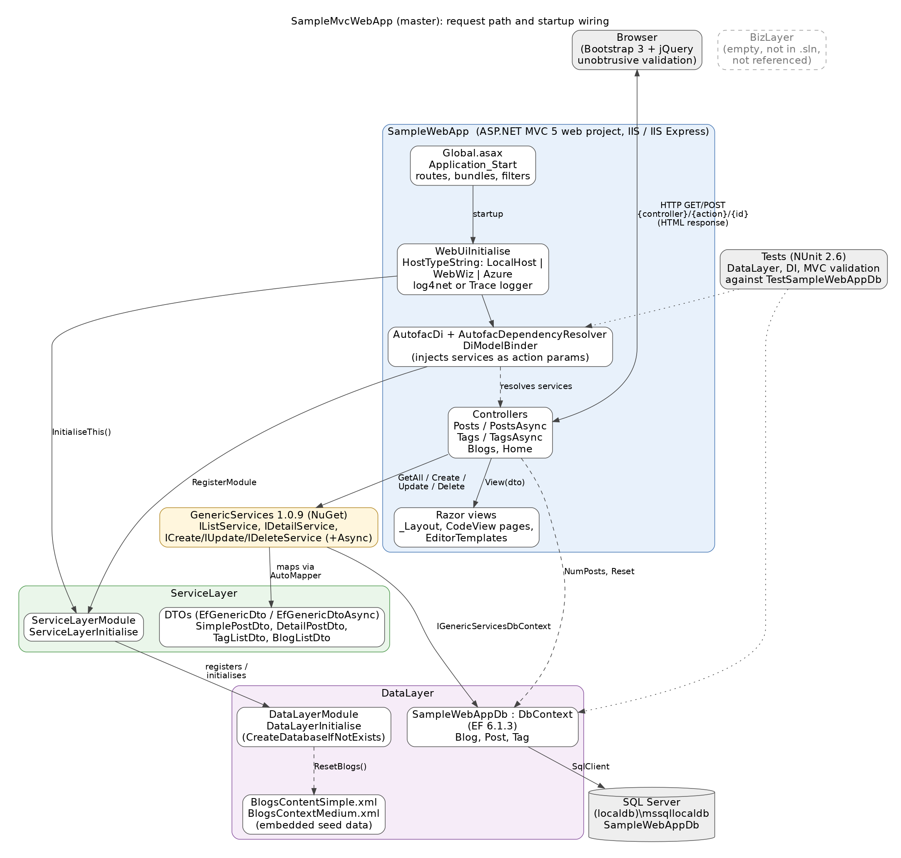

SampleMvcWebApp
===============

SampleMvcWebApp is an ASP.NET MVC5 web site designed to show a number of useful methods for building enterprise
 grade web applications using ASP.NET MVC5 and Entity Framework 6. 
The code for this sample MVC web application, and the associated 
[GenericServices Framework](https://github.com/JonPSmith/GenericServices) are both an open source project 
by [Jon Smith](http://www.thereformedprogrammer.net/about-me/) 
under the [MIT licence](http://opensource.org/licenses/MIT).

This code was published as a [live web site](http://samplemvcwebapp.net/) which includes explanations 
of the code - see an example of this on the [Posts code explanation](http://samplemvcwebapp.net/Posts/CodeView) page.
The live sites may no longer be online; the same explanations are in each section's `CodeView` page when you run the app locally.

The GenericServices Framework is available on [GitHub](https://github.com/JonPSmith/GenericServices) and on
[NuGet](https://www.nuget.org/packages/GenericServices/); this site uses version 1.0.9.

**An additional, more complex example is available.** 
Visit [Complex.SampleMvcWebApp](http://complex.samplemvcwebapp.net/) to see more.

## Architecture

See [docs/architecture.md](docs/architecture.md) for how the projects fit together, the startup and request flow,
and the data model.

## Repository layout

| Path | Contents |
| --- | --- |
| `SampleWebApp/` | ASP.NET MVC 5 web project (.NET Framework 4.5.1): controllers, Razor views, startup, Autofac and log4net setup |
| `ServiceLayer/` | GenericServices DTOs and UI helper classes |
| `DataLayer/` | Entity Framework 6 `SampleWebAppDb` context, Blog/Post/Tag entities and embedded XML seed data |
| `Tests/` | NUnit 2.6 tests (data layer tests need SQL Server) |
| `BizLayer/` | Empty placeholder project; not part of `SampleWebApp.sln` |
| `docs/` | Architecture doc and diagram source (`docs/diagrams/architecture.dot`, render with `render.sh`) |

## Getting started

1. Open `SampleWebApp.sln` in Visual Studio 2013 or later on Windows, with the .NET Framework 4.5.1 targeting pack.
   NuGet restores the `packages.config` dependencies into `packages/` on build.
2. Install SQL Server Express LocalDB. `SampleWebApp/Web.config` uses `(localdb)\mssqllocaldb`, database
   `SampleWebAppDb`; Entity Framework creates the database on first use (there are no migrations).
3. Run `SampleWebApp` (IIS Express). The database starts empty: use **Reset** on the Posts page (`/Posts/Reset`)
   to load the sample blogs, posts and tags.
4. Run the NUnit tests in `Tests/` with an NUnit 2.6 runner. They use database `TestSampleWebAppDb` from
   `Tests/App.config`.

## Features

The specific features in the code in this example are:

### 1. Simple, but robust database services

Database accesses are normally a big part of enterprise systems built with ASP.NET MVC. 
However, my experience is that creating these services in a robust and comprehensive form can lead to 
a lot of repetitive code that does the same thing, but for different data. 
My aim has been to produce a generic framework that handles most of the cases, and is 
easily extensible when special handling is required. Examples of their use on this web site are:

 - See normal, synchronous access using a DTO for shaping in the [Posts Controller](SampleWebApp/Controllers/PostsController.cs)
 - See new EF6 async access using a DTO for shaping in the [PostsAsync Controller](SampleWebApp/Controllers/PostsAsyncController.cs)
 - See normal, synchronous access directly via data class in the [Tags Controller](SampleWebApp/Controllers/TagsController.cs)
 - See new EF6 async access directly via data class in the [TagsAsync Controller](SampleWebApp/Controllers/TagsAsyncController.cs)

### 2. Use of Dependency Injection

The GenericService framework is designed specifically to work with Dependency Injection (DI). 
DI is used throughout this web site, but specific examples are:

 - Inserting the required services into a controller by action parameter injection.
 - DI is also used for creating the GenericService etc. See the `CodeView` pages and [docs/architecture.md](docs/architecture.md#startup) for more information.

Note that the SampleMvcWebApp uses AutoFac dependency injection framework, 
but the framework allows you to replace AutoFac with your own favourite DI tool.
