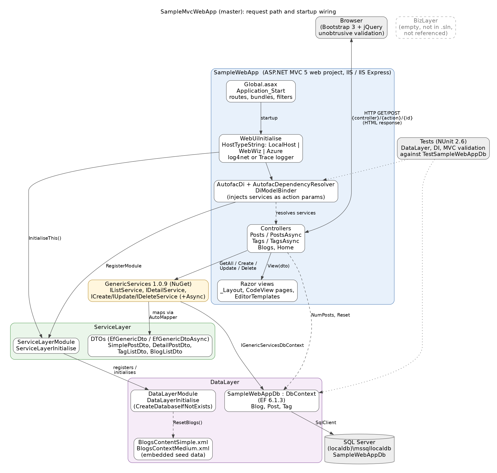

# SampleMvcWebApp architecture

This page describes what the code on `master` does today. It is an ASP.NET MVC 5 sample site on
.NET Framework 4.5.1 that shows how to build CRUD pages over Entity Framework 6 with the
[GenericServices](https://github.com/JonPSmith/GenericServices) library and Autofac dependency injection.
The domain is a small blog: **Blogs** (bloggers), **Posts** and **Tags**.

The diagram source is [`diagrams/architecture.dot`](diagrams/architecture.dot) (Graphviz). After editing it, run
[`diagrams/render.sh`](diagrams/render.sh) to regenerate `architecture.png` and `architecture.svg`.

## Projects

| Project | In `SampleWebApp.sln` | What it holds | References |
| --- | --- | --- | --- |
| `SampleWebApp` | yes | MVC 5 web project: controllers, Razor views, startup, DI and logging setup | DataLayer, ServiceLayer |
| `ServiceLayer` | yes | GenericServices DTOs that shape Posts, Tags and Blogs for the UI; dropdown/multi-select helpers; Autofac module | DataLayer |
| `DataLayer` | yes | EF6 `SampleWebAppDb` context, entity classes, database initialiser, embedded XML seed data; Autofac module | none |
| `Tests` | yes | NUnit 2.6 tests for the data layer, DI wiring and MVC validation helpers | DataLayer, ServiceLayer, SampleWebApp |
| `BizLayer` | **no** | Empty `BizLayerInitialise` / `BizLayerModule` placeholders | DataLayer (nothing references BizLayer) |

All projects use `packages.config` NuGet packages (restored into `packages/`). Main versions: ASP.NET MVC 5.2.3,
Entity Framework 6.1.3, GenericServices 1.0.9, GenericLibsBase 1.0.1, AutoMapper 4.2.1, Autofac 3.5 (+ Autofac.Mvc5),
DelegateDecompiler 0.18, log4net 2.0.3, Bootstrap 3.3.2 and jQuery 1.10.2.

## Startup

`Global.asax.cs` (`MvcApplication.Application_Start`) runs once per app domain:

1. Registers areas, the global `HandleErrorAttribute`, the default route `{controller}/{action}/{id}` (defaults to
   `Home/Index`) and the script/style bundles (`App_Start/`).
2. Replaces the default model binder with `Infrastructure/DiModelBinder`, which asks the MVC dependency resolver for
   any action parameter whose type is an interface. This is how actions receive `IListService`, `ICreateService`, etc.
   as parameters.
3. Calls `Infrastructure/WebUiInitialise.InitialiseThis`, which:
   - reads `HostTypeString` from the `applicationSettings` section of `Web.config` (`LocalHost` by default; the
     `Web.AzureRelease.config` and `Web.WebWizRelease.config` transforms set `Azure` and `WebWiz`);
   - sets up logging: log4net from `Log4Net.xml` for `LocalHost`/`WebWiz`, `System.Diagnostics.Trace` for `Azure`,
     plugged into GenericLibsBase so the libraries log through it;
   - calls `ServiceLayerInitialise.InitialiseThis`, which calls `DataLayerInitialise.InitialiseThis`. That sets the EF
     database initialiser to `CreateDatabaseIfNotExists<SampleWebAppDb>` (or `NullDatabaseInitializer` on WebWiz,
     which does not allow creating databases) and turns on the SQL Azure retry strategy in `EfConfiguration` for Azure;
   - builds the Autofac container (`Infrastructure/AutofacDi`): `ServiceLayerModule` registers `DataLayerModule`,
     every ServiceLayer type by its interfaces, and every GenericServices type by its interfaces. `SampleWebAppDb` is
     registered as itself and as `IGenericServicesDbContext`, one instance per lifetime scope (one per request in MVC);
   - installs `AutofacDependencyResolver` as the MVC dependency resolver.

## Request flow

1. The browser requests `/{controller}/{action}/{id}`. The layout (`Views/Shared/_Layout.cshtml`) has a
   "Sync database" menu (Posts, Tags, Blogs) and an "Async database" menu (PostsAsync, TagsAsync).
2. MVC creates the controller; `DiModelBinder` resolves the GenericServices interfaces the action asks for.
3. The action calls the service. GenericServices uses `SampleWebAppDb` and AutoMapper (through the DTO's
   `EfGenericDto<TEntity, TDto>` base class) to read or write the entity.
4. Write actions return `ISuccessOrErrors`. On success the controller puts the message in `TempData` and redirects to
   `Index`; on failure `Infrastructure/ValidationHelper.CopyErrorsToModelState` copies the errors into `ModelState`
   and the form is shown again.
5. The Razor view renders the DTO or entity. Each section also has a `CodeView` page that explains its code.

| Controller | Pattern it demonstrates | Services / models |
| --- | --- | --- |
| `PostsController` | Sync CRUD through DTOs | `SimplePostDto` (list), `DetailPostDto` (detail/create/edit, with blogger dropdown and tag multi-select); `Index` takes an optional blog id filter |
| `PostsAsyncController` | Async CRUD through DTOs | `SimplePostDtoAsync`, `DetailPostDtoAsync` and the `*ServiceAsync` interfaces |
| `TagsController` / `TagsAsyncController` | Sync / async CRUD directly on the `Tag` entity | `TagListDto` for the list only |
| `BlogsController` | Sync CRUD directly on the `Blog` entity | `BlogListDto` for the list only |
| `HomeController` | Static pages and an `Internals` page | `InternalsInfo` (thread pool and memory counters) |

`PostsController` and `PostsAsyncController` also take `SampleWebAppDb` directly for `NumPosts` (post count) and
`Reset`, which calls `DataLayerInitialise.ResetBlogs` to delete all rows and reload `BlogsContextMedium.xml`.
`Delay` sleeps 500 ms to show sync vs async behaviour.

## Data model

`DataLayer/DataClasses/SampleWebAppDb.cs` is the only `DbContext`. It uses the connection string named
`SampleWebAppDb`; `Web.config` points it at `(localdb)\mssqllocaldb`, database `SampleWebAppDb`. There are no EF
migrations: the schema is created by convention the first time the database is used.

- `Blog`: `BlogId`, `Name` (2-64 chars), `EmailAddress`; has many `Posts`.
- `Post`: `PostId`, `Title` (2-128 chars, no `!`, must not end in `?`), `Content`, `BlogId`, `LastUpdated`; belongs to
  one `Blog`; must have at least one `Tag`. Inherits `TrackUpdate`, which stamps `LastUpdated`.
- `Tag`: `TagId`, `Slug` (word characters only, unique), `Name`; many-to-many with `Post`.

`SampleWebAppDb` overrides `SaveChanges`/`SaveChangesAsync` to stamp `LastUpdated`, and `ValidateEntity` to reject a
duplicate `Tag.Slug`. GenericServices' `SaveChangesWithChecking` turns these validation errors into `ISuccessOrErrors`.

Seed data is not loaded automatically. `BlogsContentSimple.xml` and `BlogsContextMedium.xml` are embedded resources
in DataLayer, read by `Startup/Internal/LoadDbDataFromXml`; the web app loads the medium set from the Posts `Reset`
action, and the tests load either set.

## Tests

`Tests/` is an NUnit 2.6 project (54 tests). `Group01DataLayer` writes to a real SQL Server database
(`TestSampleWebAppDb`, connection string in `Tests/App.config`), `Group03ServiceLayer` checks the Autofac modules,
and `Group06Mvc` checks `ValidationHelper`. `Tests/Docs` and `Tests/TestData` hold leftovers from an older
"ActionRunner" feature that is no longer in the web app.

## What is not used

Several packages and files are still in the projects but nothing on `master` calls them: ASP.NET Identity, OWIN
security providers (`owin:AutomaticAppStartup` is `false` in `Web.config`), SignalR, jQuery UI, jQuery Notify and the
`ActionRunner*.js` scripts (their bundle is commented out in `BundleConfig`), and the `BizLayer` project.
