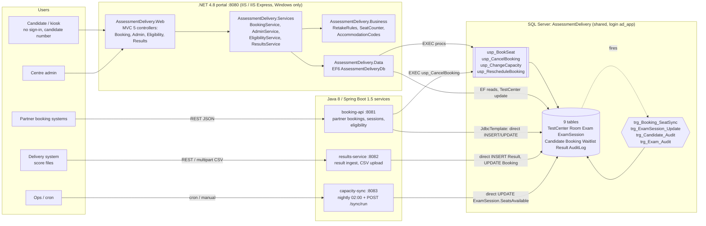
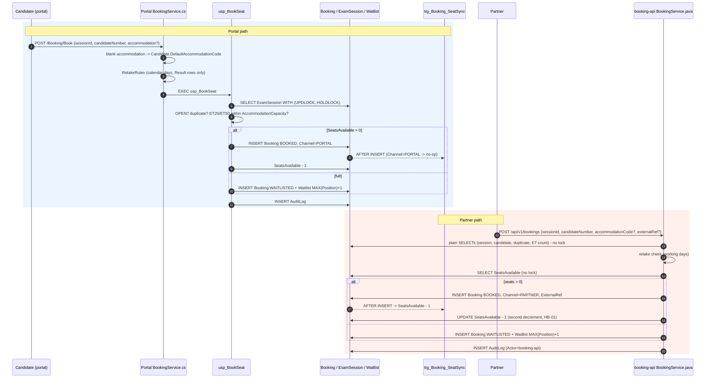
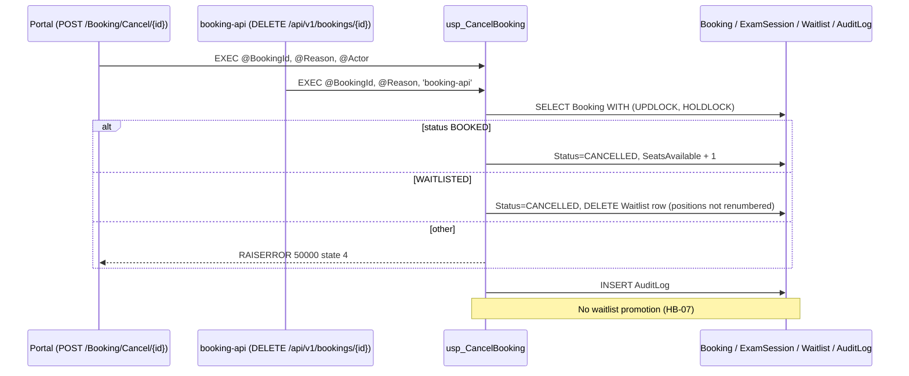
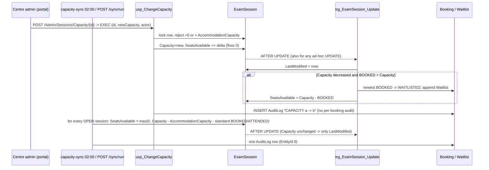
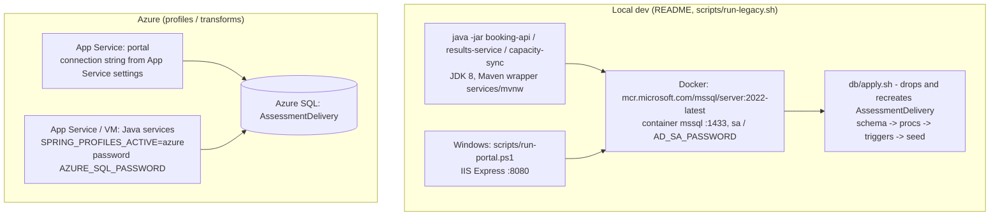

# As-is architecture (legacy estate)

Scope: tag `legacy-baseline` (`e458238`). Derived from the code and from running the estate on
Linux (SQL Server 2022 container + the three Java services via `scripts/run-legacy.sh`). The
portal's behaviour comes from its C# source; its database effects were reproduced by calling the
same stored procedures with the same arguments. Companion documents:
[data-ownership.md](data-ownership.md), [hidden-behavior.md](hidden-behavior.md),
[migration-risks.md](migration-risks.md).

## 1. Components

| Component | Tech | Talks to DB via | Key source |
|---|---|---|---|
| Portal | .NET Framework 4.8, ASP.NET MVC 5, EF6, Autofac | EF6 for reads and `TestCenter` edits; `ExecuteSqlCommand` for all booking / capacity writes (procs) | `AssessmentDelivery.Web/Controllers/*.cs`, `AssessmentDelivery.Services/**`, `AssessmentDelivery.Business/Rules/*.cs` |
| booking-api | Java 8, Spring Boot 1.5, JdbcTemplate | inline SQL; **only** `usp_CancelBooking` is used; booking/reschedule bypass `usp_BookSeat` | `services/booking-api/src/main/java/com/northwind/assessment/booking/**` |
| results-service | Java 8, Spring Boot 1.5, JdbcTemplate | inline SQL | `services/results-service/src/main/java/com/northwind/ad/results/**` |
| capacity-sync | Java 8, Spring Boot 1.5, `@Scheduled(cron = "0 0 2 * * *")` | inline SQL | `services/capacity-sync/src/main/java/com/northwind/assessment/capacity/**` |
| Database | SQL Server 2016+ / Azure SQL | 4 procs, 4 triggers, 9 tables, `db/checks/*.sql` diagnostics | `db/schema`, `db/procs`, `db/triggers`, `db/seed`, `db/checks` |

### Endpoints

| Stack | Route | Effect on DB |
|---|---|---|
| Portal | `GET /Booking` | EF: OPEN sessions, `StartsAt >= today` |
| Portal | `POST /Booking/Book` | retake check (C#) -> `EXEC usp_BookSeat` |
| Portal | `POST /Booking/Cancel/{id}` | `EXEC usp_CancelBooking` |
| Portal | `POST /Booking/Reschedule/{id}` | retake check (C#) -> `EXEC usp_RescheduleBooking` |
| Portal | `GET /Eligibility?candidateNumber=&examCode=&date=` | EF: `Result` rows -> `RetakeRules` (calendar days) |
| Portal | `GET /Results?candidateNumber=` | EF read |
| Portal | `GET/POST /Admin/EditCenter` | EF `SaveChanges` on `TestCenter` (no proc, no audit) |
| Portal | `GET/POST /Admin/Sessions/Capacity/{id}` | `EXEC usp_ChangeCapacity` (-> `trg_ExamSession_Update`) |
| booking-api | `GET /api/v1/sessions?examCode=&centerCode=&from=&to=` | read, all statuses, TOP 500 |
| booking-api | `GET /api/v1/sessions/{id}` | read + live booked count |
| booking-api | `POST /api/v1/bookings` | Java checks -> `INSERT Booking` (PARTNER) -> `UPDATE ExamSession SeatsAvailable-1` -> (`trg_Booking_SeatSync` -1 again) -> `INSERT AuditLog`; or `INSERT Waitlist` |
| booking-api | `GET /api/v1/bookings/{id}` | read |
| booking-api | `DELETE /api/v1/bookings/{id}?reason=` | `EXEC usp_CancelBooking` |
| booking-api | `POST /api/v1/bookings/{id}/reschedule` | Java cancel (proc) + Java book (direct) in one transaction |
| booking-api | `GET /api/v1/candidates/{no}/bookings` | read |
| booking-api | `GET /api/v1/candidates/{no}/eligibility?examCode=&date=` | `Result` rows -> working-day rule |
| results-service | `POST /api/v1/results` | `INSERT Result`, `UPDATE Booking -> ATTENDED`, `INSERT AuditLog` |
| results-service | `POST /api/v1/results/upload` | same, row by row |
| results-service | `GET /api/v1/results/candidate/{no}` | read |
| capacity-sync | `POST /sync/run`, cron 02:00 | `UPDATE ExamSession SeatsAvailable` for OPEN sessions, one `AuditLog` row |
| capacity-sync | `GET /sync/last` | in-memory last run |

## 2. Request flows

### 2.1 Booking

### 2.2 Cancellation

### 2.3 Capacity change

### 2.4 Retake check

```mermaid
flowchart TB
  subgraph Portal
    P1[Book / Reschedule / GET /Eligibility] --> P2[EligibilityService.cs<br/>attempts = Result rows for candidate+exam]
    P2 --> P3{any Passed?}
    P3 -- yes --> PB[Blocked: already passed]
    P3 -- no --> P4["earliest = max(SessionDate).Date + RetakeWaitDays (calendar)"]
    P4 --> P5{requested.Date < earliest?}
    P5 -- yes --> PW[Blocked: wait]
    P5 -- no --> PA[Allowed -> EXEC usp_BookSeat]
  end
  subgraph Java[booking-api]
    J1[POST bookings / reschedule / GET eligibility] --> J2[ResultDao<br/>Result rows ordered by StartsAt desc]
    J2 --> J3{any Passed?}
    J3 -- yes --> JB[ALREADY_PASSED]
    J3 -- no --> J4["earliest = addWorkingDays(last, RetakeWaitDays)<br/>JVM default time zone"]
    J4 --> J5{onDate before earliest?}
    J5 -- yes --> JW[RETAKE_WAIT_NOT_ELAPSED]
    J5 -- no --> JA[Allowed -> direct INSERT]
  end
  DBX[(usp_BookSeat / direct SQL / IMPORT:<br/>no retake check at all)]
```

Confirmed difference: failed 2026-11-07, wait 30 -> portal earliest 2026-12-07, Java 2026-12-18
([HB-04](hidden-behavior.md#hb-04)).

## 3. Deployment and configuration

| Setting | Where | Value (local) |
|---|---|---|
| Portal connection string | `AssessmentDelivery.Web/Web.config:12` | `localhost,1433`, `ad_app`, `MultipleActiveResultSets=True`, `Application Name=AssessmentDeliveryPortal` |
| Portal app settings | `AssessmentDelivery.Web/Web.config:20-27` | `Portal.KioskMode=false`, `Portal.ResultsReleaseDelayHours=0`, environment name/build |
| booking-api | `services/booking-api/src/main/resources/application.properties` | port 8081, pool 20, `booking.channel=PARTNER`, `booking.audit-actor=booking-api`, password `${AD_DB_PASSWORD:...}` |
| results-service | `services/results-service/src/main/resources/application.properties` | port 8082, pool 20, 5 MB upload, `results.audit-actor=results-service` |
| capacity-sync | `services/capacity-sync/src/main/resources/application.properties` | port 8083, pool 5, `capacity.sync.audit-actor=capacity-sync`; cron in code (`NightlySyncJob.java:14`, server time) |
| Azure profiles | `services/*/src/main/resources/application-azure.properties` | placeholder server/user, `AZURE_SQL_PASSWORD` |
| DB login | `db/schema/000_create_database.sql:13-26` | `ad_app` in `db_datareader` + `db_datawriter` + `GRANT EXECUTE`; every component shares this one login, so `AuditLog.Actor` from triggers is the SQL login, not the app |

Operational facts observed while running:
- `scripts/run-legacy.sh` always re-creates the database (`SKIP_DB=1` keeps it); a fresh seed has zero
  rows in `db/checks/seat-drift.sql`.
- Java unit tests: 5 tests across the three modules, all pass (`services/mvnw -B test`); none touches
  the database, concurrency, triggers or channel parity.
- No job in the repository moves sessions OPEN -> CLOSED/DELIVERED although `NightlySyncJob.java:13`
  refers to a "01:00 session close-out" ([HB-13](hidden-behavior.md#hb-13)).
