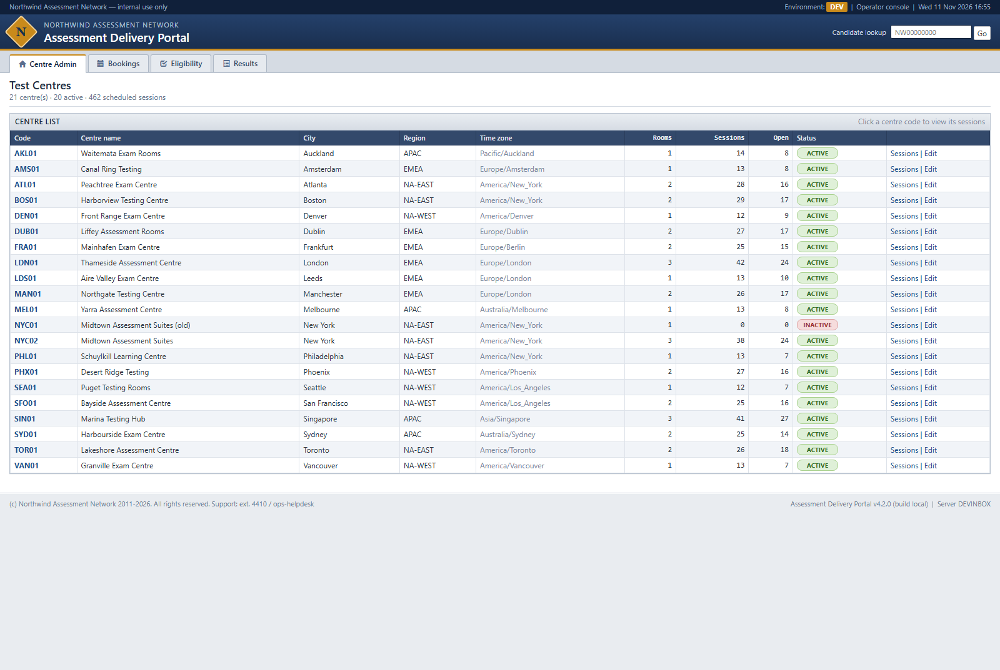
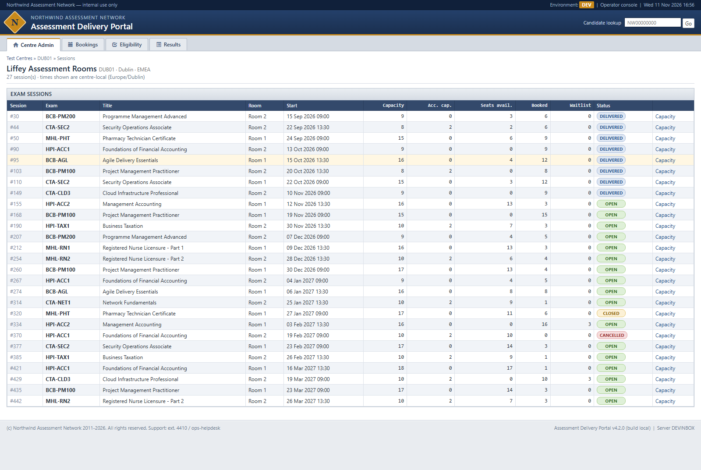
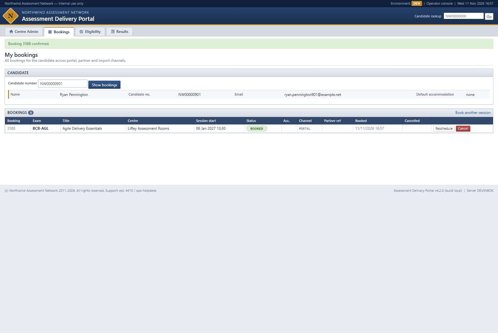
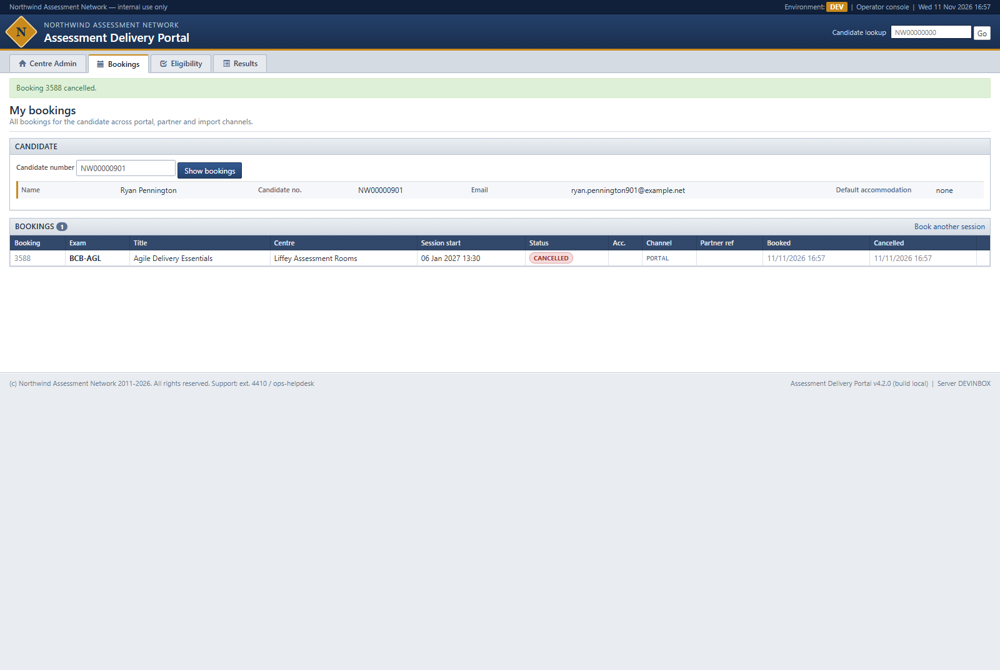
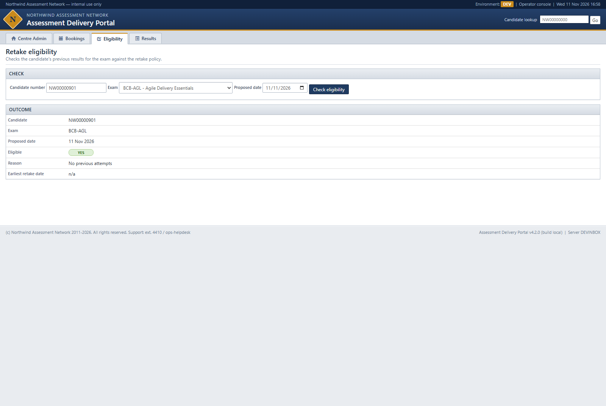
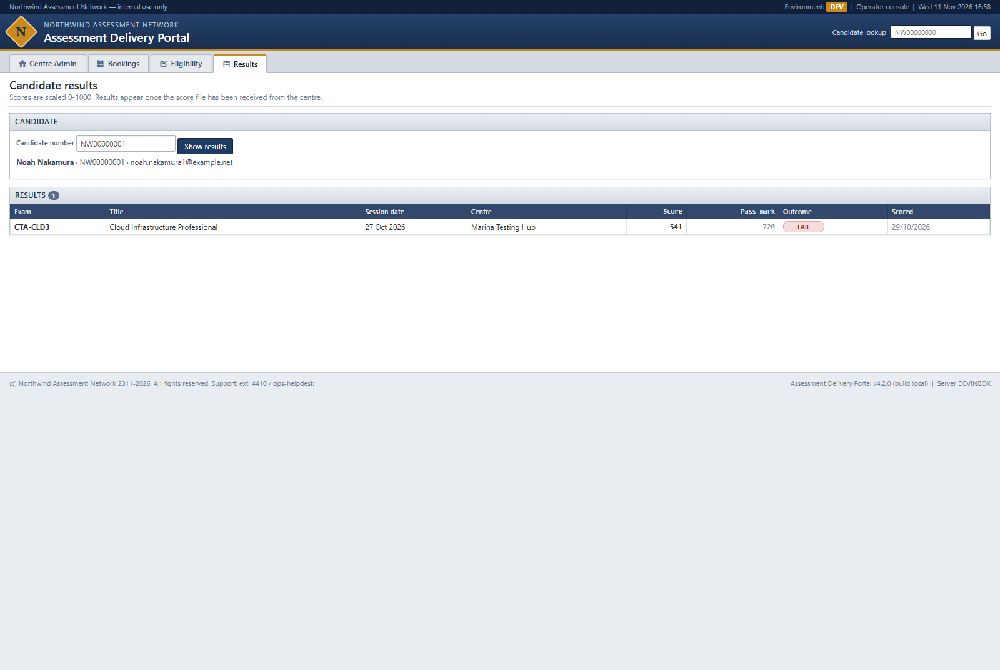

# Legacy estate smoke test (Windows, local)

Northwind Assessment Network: legacy Assessment Delivery estate brought up on a clean Windows VM with `scripts\run-legacy.ps1`, then smoke-tested through the portal UI (recorded) and the three Java services' HTTP endpoints.

| | |
|---|---|
| Date | 2026-11-11 (VM clock 16:50-17:00 UTC) |
| Commit | `e458238da39c991b51d8f670f6d0c463b51b372f` (tag `legacy-baseline`, branch `estate/legacy-baseline`) |
| Result | **10 / 10 checks PASS** (7 portal checks, of which book and cancel were confirmed with SQL before/after, plus 3 service endpoints) |

## Environment and versions

| Component | Version (observed on the VM) |
|---|---|
| OS | Windows Server 2022 Standard 10.0.20348 (Hypervisor) |
| SQL Server | Microsoft SQL Server 2022 (RTM) 16.0.1000.6, Express Edition (64-bit), default instance `MSSQLSERVER` on `localhost,1433` - installed by the script |
| sqlcmd | go-sqlcmd v1.6.0 (`C:\Program Files\SqlCmd\sqlcmd.exe`) - installed by the script via Chocolatey |
| .NET Framework | 4.8 (release key 533325); portal targets `v4.8`, ASP.NET MVC 5.2.9, EntityFramework 6.4.4 |
| MSBuild / NuGet | MSBuild 17.14.60 (VS 2022 Build Tools), NuGet 7.9.0 |
| IIS Express | 10.0.20001.1000, portal on `http://localhost:8080/` |
| JDK used by the services | Temurin 1.8.0_472 (the script picks JDK 8; Temurin 21 is also installed but unused) |
| Maven | wrapper 3.3.2 -> Apache Maven 3.8.8; services on Spring Boot 1.5.22.RELEASE |
| Services | booking-api :8081, results-service :8082, capacity-sync :8083 (each started in ~2.4 s) |

## Setup steps and time taken

All commands from a checkout of `legacy-baseline` (`C:\Users\Administrator\repos\SampleMvcWebApp`), elevated shell.

1. Pre-seed Maven so the build does not depend on `repo.maven.apache.org` (see friction below):
   - `~/.m2/settings.xml` with a mirror `mirrorOf=central` -> `https://maven-central.storage-download.googleapis.com/maven2/`
   - unzip `apache-maven-3.8.8-bin.zip` (from the same mirror) into `~/.m2/wrapper/dists/apache-maven-3.8.8/bec3b5eec6da8a18f9ebb3d68bd1f3da/` (the directory name is the MD5 of the wrapper `distributionUrl`; `bin/` sits directly under it).
   - `MVNW_REPOURL` left unset (wrapper 3.3.2 builds a broken URL when it is set).
2. `powershell -ExecutionPolicy Bypass -File scripts/run-legacy.ps1` (from Git Bash: forward slash in the path, stdin redirected `< /dev/null`).
3. `powershell -ExecutionPolicy Bypass -File scripts/run-legacy.ps1 -Status`.

Observed timeline (script output plus file timestamps):

| Step | Start | End | Duration |
|---|---|---|---|
| sqlcmd install (Chocolatey `sqlcmd` 1.6.0) | 16:51:00 | ~16:51:05 | ~5 s |
| Download SQL Server 2022 Express (279 MB) | ~16:51:05 | 16:51:23 | ~18 s |
| Extract + unattended install (`Summary.txt`: Final result Passed, exit 0) | 16:51:23 | 16:53:44 | ~2 min 20 s |
| `db\apply.ps1` drop/create `AssessmentDelivery` + seed | 16:53:45 | ~16:53:50 | ~5 s |
| Maven build of `services\` (JDK 8) | ~16:53:50 | ~16:54:12 | ~20 s |
| Java services up (booking-api, results-service, capacity-sync) | 16:54:13 | 16:54:18 | ~5 s |
| Portal: NuGet restore + MSBuild Debug + IIS Express | 16:54:18 | 16:54:56 | ~40 s |
| **Total, bare VM to "all components up"** | 16:51:00 | 16:54:56 | **~4 min** |

Seed row counts reported by `db\apply.ps1`: TestCenter 21, Room 36, Exam 12, ExamSession 462, Candidate 1000, Booking 3587, Waitlist 34, Result 1444, AuditLog 12.

`-Status` after start-up (and again after the smoke test):

```text
sql-server       :1433 listening MSSQLSERVER=Running
booking-api      :8081 up   pid 5684
results-service  :8082 up   pid 6796
capacity-sync    :8083 up   pid 7312
portal           :8080 up   IIS Express pid 8944
```

## Setup friction and how it was solved

| Friction | Fix |
|---|---|
| No `sqlcmd` and no SQL Server on the VM | None needed: the script installed go-sqlcmd via Chocolatey and SQL Server 2022 Express (default instance, TCP 1433, mixed mode) unattended. |
| Maven Central (`repo.maven.apache.org`) is known to return HTTP 429 to this VM pool, both for dependencies and for the wrapper's own Maven 3.8.8 download | Pre-seeded `~/.m2/settings.xml` mirror and the wrapper distribution (step 1). With that the build ran first time; no 429 was hit in this run. |
| `services\mvnw.cmd` (wrapper 3.3.2) fails ("Cannot start maven from wrapper") if `MVNW_REPOURL` is set | Leave it unset; the script also comments on this. |
| `-File scripts\run-legacy.ps1` from Git Bash fails ("argument 'scriptsrun-legacy.ps1' does not exist") because bash eats the backslash | Use `scripts/run-legacy.ps1`. |
| PowerShell / go-sqlcmd launched from a non-interactive shell can hang waiting on stdin | Redirect stdin: `powershell ... < /dev/null`, `sqlcmd ... < /dev/null`. |
| IIS Express on :8080 listens through http.sys, so the port owner shows as PID 4 | The script finds the portal by the `iisexpress.exe` command line (pid 8944 here); probe it with `curl` rather than by port owner. |

No repo code was changed.

## Results

Portal walk driven in a browser by the testing agent (one recording); each write confirmed with SQL (`sqlcmd -S localhost,1433 -E -C -d AssessmentDelivery -W`). Service endpoints checked with `curl`.

| # | Page / endpoint | Result | Observed | Evidence |
|---|---|---|---|---|
| 1 | `GET /` + branding | PASS | 302 to `/Admin/Centers`. Header "NORTHWIND ASSESSMENT NETWORK / Assessment Delivery Portal", top bar "Northwind Assessment Network - internal use only", footer "(c) Northwind Assessment Network 2011-2026", "Assessment Delivery Portal v4.2.0 (build local)". No other brand. | [01](img/smoke/01-home-centers.png) |
| 2 | `/Admin/Centers` | PASS | "21 centre(s) - 20 active - 462 scheduled sessions"; NYC01 shown INACTIVE with 0 sessions. Matches seed (TestCenter 21, ExamSession 462). | [01](img/smoke/01-home-centers.png) |
| 3 | `/Admin/Sessions?centerId=...` (DUB01) | PASS | 27 sessions listed with status, capacity and seats. | [02](img/smoke/02-center-sessions.png) |
| 4 | `/Booking` search + book, candidate NW00000901 | PASS | Session 274 (BCB-AGL, Liffey Assessment Rooms, 06 Jan 2027 13:30, 8 free). Booking 3588 confirmed. SQL: Booking 3588 `BOOKED`, `Channel=PORTAL`; SeatsAvailable 8 -> 7. | [03](img/smoke/03-booking-confirmation.png), SQL A/B |
| 5 | `/Booking/MyBookings?candidateNumber=NW00000901` + cancel | PASS | Booking 3588 listed; cancelled with reason "Legacy portal recorded smoke test"; banner "Booking 3588 cancelled.", status CANCELLED. SQL: `CANCELLED`, `CancelledAt`/`CancelReason` set; SeatsAvailable 7 -> 8. | [04](img/smoke/04-my-bookings-cancelled.png), SQL C |
| 6 | `/Eligibility` (NW00000901, BCB-AGL, 11 Nov 2026) | PASS | Eligible: YES, "No previous attempts", earliest retake n/a. SQL: no `Result` rows for CandidateId 901. | [05](img/smoke/05-eligibility.png), SQL D |
| 7 | `/Results?candidateNumber=NW00000001` | PASS | CTA-CLD3 Cloud Infrastructure Professional, score 541, pass mark 720, FAIL. Matches `Result` 1074 (`Passed=0`). | [06](img/smoke/06-results.png), SQL D |
| 8 | booking-api `GET :8081/api/v1/sessions` | PASS | HTTP 200, 170,470 B JSON array of sessions (0.70 s). | curl below |
| 9 | results-service `GET :8082/api/v1/results/candidate/NW00000001` | PASS | HTTP 200, one result (resultId 1074, score 541, passed false) - same row as the portal. | curl below |
| 10 | capacity-sync `GET :8083/sync/last` | PASS | HTTP 200, `status: NEVER_RUN` (no sync has run since start-up). | curl below |

### SQL evidence (portal writes)

A - before booking:

```text
> SELECT SessionId, Capacity, SeatsAvailable, Status FROM dbo.ExamSession WHERE SessionId=274;
> SELECT * FROM dbo.Booking WHERE CandidateId=901;
SessionId Capacity SeatsAvailable Status
274 16 8 OPEN
(0 rows affected)
```

B - after booking (16:57:30):

```text
BookingId SessionId CandidateId Status AccommodationCode Channel ExternalRef BookedAt CancelledAt CancelReason LastModified
3588 274 901 BOOKED NULL PORTAL NULL 2026-11-11 16:57:30.173 NULL NULL 2026-11-11 16:57:30.173
SessionId Capacity SeatsAvailable Status
274 16 7 OPEN
```

C - after cancel (16:57:58):

```text
BookingId SessionId CandidateId Status AccommodationCode Channel ExternalRef BookedAt CancelledAt CancelReason LastModified
3588 274 901 CANCELLED NULL PORTAL NULL 2026-11-11 16:57:30.173 2026-11-11 16:57:58.467 Legacy portal recorded smoke test 2026-11-11 16:57:58.467
SessionId Capacity SeatsAvailable Status
274 16 8 OPEN
```

Cross-check afterwards: `SELECT COUNT(*) FROM dbo.Booking WHERE SessionId=274 AND Status='BOOKED'` -> 8 = Capacity 16 - SeatsAvailable 8 (no drift on this session). Total `dbo.Booking` rows 3587 -> 3588.

D - results / eligibility:

```text
> SELECT r.*, e.ExamCode FROM dbo.Result r JOIN dbo.Exam e ON e.ExamId=r.ExamId WHERE r.CandidateId=1;
ResultId BookingId CandidateId ExamId SessionId Score Passed ScoredAt SourceFile ReceivedAt ExamCode
1074 1224 1 9 118 541 0 2026-10-29 06:15:00.000 NW_SCORES_CTA_20261029.csv 2026-10-29 06:54:00.000 CTA-CLD3
> SELECT * FROM dbo.Result WHERE CandidateId=901;
(0 rows affected)
```

### Service endpoints (curl)

```text
$ curl -s -w "HTTP %{http_code} %{size_download}B %{time_total}s" http://localhost:8081/api/v1/sessions
[ { "sessionId" : 1, "examCode" : "CTA-NET1", "examTitle" : "Network Fundamentals", "centerCode" : "SEA01",
    "centerName" : "Puget Testing Rooms", "roomName" : "Room 1", "startsAt" : "2026-09-01T09:00:00", "capacity" : 15,
    "accommodationCapacity" : 0, "seatsAvailable" : 8, "status" : "DELIVERED", "bookedSeats" : null }, ...
HTTP 200 170470B 0.697652s

$ curl -s http://localhost:8082/api/v1/results/candidate/NW00000001
[ { "resultId" : 1074, "bookingId" : 1224, "examCode" : "CTA-CLD3", "examTitle" : "Cloud Infrastructure Professional",
    "sessionId" : 118, "sessionDate" : "2026-10-27", "score" : 541, "passed" : false,
    "scoredAt" : "2026-10-29T06:15:00", "sourceFile" : "NW_SCORES_CTA_20261029.csv" } ]
HTTP 200 315B 0.535042s

$ curl -s http://localhost:8083/sync/last
{ "status" : "NEVER_RUN", "trigger" : null, "startedAt" : null, "finishedAt" : null,
  "sessionsChecked" : 0, "sessionsUpdated" : 0, "message" : null }
HTTP 200 171B 0.077440s
```

## Observations for the as-is deep dive (not failures)

- `GET /` has no landing page of its own; it redirects to `/Admin/Centers`, so the operator console is the home page and there is no login.
- Portal book/cancel also writes `dbo.AuditLog` (seed 12 -> 14 rows) with **different actors for the two writes**: `BOOK` is logged as `ad_app` (the SQL login), `CANCEL` as `portal`. Detail text also differs (`session=274 status=BOOKED` vs the cancel reason).
  ```text
  AuditId EntityName EntityId Action Detail Actor LoggedAt
  14 Booking 3588 CANCEL Legacy portal recorded smoke test portal 2026-11-11 16:57:58.470
  13 Booking 3588 BOOK session=274 status=BOOKED ad_app 2026-11-11 16:57:30.190
  ```
- booking-api `/api/v1/sessions` returned `"bookedSeats" : null` next to `seatsAvailable` in the sampled rows (e.g. session 1), so the list exposes the stored `SeatsAvailable` counter rather than a computed booking count.
- `BookedAt`, `CancelledAt` and `LoggedAt` were written with the server clock (the VM runs on UTC: booking at 16:57:30 UTC is stored as `16:57:30.173`), even though the session is at a Europe/Dublin centre; `/Admin/Centers` shows a per-centre time zone that these columns do not use.
- The smoke test leaves one `CANCELLED` booking (3588) for NW00000901; session 274 seats are back to 8. Re-run `scripts\run-legacy.ps1` (without `-SkipDb`) to reseed.

## Screenshots

| | |
|---|---|
|  |  |
|  |  |
|  |  |
